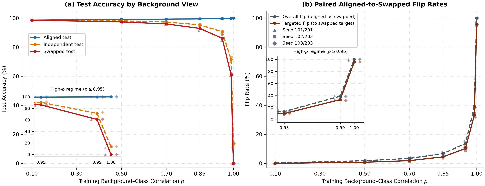

# Colored MNIST Shortcuts

## Introduction

**Shortcut learning** occurs when a model learns a rule that works under familiar test conditions but fails when those conditions change. Geirhos et al. document this behavior in deep neural networks across several tasks. [*Shortcut Learning in Deep Neural Networks*](https://arxiv.org/abs/2004.07780)

One way a model learns a shortcut is by exploiting a **spurious correlation**. This is an association that makes a feature predictive of the target in a particular dataset even though the feature is incidental to the task. Clever Hans, a horse that appeared to solve arithmetic problems by tapping his hoof, illustrates how such a cue can lead to the right answer. Oskar Pfungst found that Hans used subtle, involuntary movements from the questioner to tell when to stop tapping. [*The “Clever Hans Phenomenon” Revisited*](https://pmc.ncbi.nlm.nih.gov/articles/PMC3921203/)

We explore how a spurious correlation can lead to shortcut learning in a controlled experiment with handwritten MNIST digits. We train CNNs while varying how often each digit class appears on its assigned background color. We then test each model on the same held-out digits with three background assignments. The color matches the digit’s class, is chosen independently of it, or comes from another class. By changing the background while keeping the digit fixed, we can measure whether accuracy falls and whether predictions shift toward the class associated with the new color.

*AI disclosure: this project was developed with AI assistance from GPT-6 Astra and Gemini 4 Argon.*

## Experiment design

### How we assign backgrounds

We render each MNIST digit in white on one of ten backgrounds with similar luminance and contrast. Each digit class has a unique preferred color. A training image gets its class’s preferred color with probability $p$. With probability $1-p$, it gets one of the other nine colors, chosen uniformly. At $p=0.10$, every color is equally likely for every digit class. At $p=1.00$, background color uniquely identifies the digit class. [See the digits across all ten backgrounds.](results/validation_sample_grid.png)

### What stays fixed during training

We split the original MNIST training set into 54,000 training and 6,000 validation images before recoloring and reserve the official 10,000 test images for final evaluation. The completed sweep covers $p \in \{0.10, 0.50, 0.70, 0.85, 0.95, 0.99, 1.00\}$, with three seed pairs per value for 21 runs. Within a seed pair, we reuse the same source images, random draws for assigning backgrounds, model initialization, and batch order across values of $p$. This isolates the effect of changing the training backgrounds within each pair.

Every run uses the same two-layer CNN, trained for 10 epochs with cross-entropy and Adam (learning rate $10^{-3}$, batch size 256). We evaluate the final checkpoint from each run.

### Three views of the same test digits

Every model sees the same 10,000 held-out digits in each of three fixed test views. A digit’s shape and label stay fixed across views.

| Test view | Background assignment |
| --- | --- |
| Aligned | The true digit’s preferred color. |
| Independent | A fixed random draw from all ten colors, independent of the label. |
| Swapped | The preferred color of digit $(y+5) \bmod 10$, where $y$ is the true label. For example, a `3` gets the preferred color of an `8`. |

We measure accuracy on each view. The **overall flip rate** is the fraction of test digits whose predicted class changes between the aligned and swapped views. The **targeted flip rate** is the fraction of aligned-correct digits that the model classifies as the digit associated with the swapped background color.

## Main results



*Lines show means across the three seed pairs. The marker shapes identify individual runs.*

| Training $p$ | Aligned accuracy | Independent accuracy | Swapped accuracy | Targeted flip rate |
| ---: | ---: | ---: | ---: | ---: |
| 0.10 | 98.58% | 98.55% | 98.55% | 0.02% |
| 0.50 | 99.07% | 98.08% | 97.38% | 0.79% |
| 0.70 | 99.27% | 97.29% | 95.98% | 1.89% |
| 0.85 | 99.45% | 95.36% | 92.89% | 4.48% |
| 0.95 | 99.64% | 90.58% | 86.12% | 10.28% |
| 0.99 | 99.86% | 71.45% | 60.87% | 33.35% |
| 1.00 | 100.00% | 13.25% | 0.00% | 95.71% |

With independent training colors ($p=0.10$), accuracy stays close to 98.6% in all three views. At $p=0.99$, aligned accuracy reaches 99.86% while swapped accuracy falls to 60.87%. At $p=1.00$, all three models classify every aligned digit correctly and every swapped digit incorrectly. On average, 95.71% of those swapped predictions land on the specific class associated with the new background color. The identity of the wrong class is evidence that the models learned the color shortcut.

[Per-run metrics](results/run_level_metrics.csv) · [Sweep summary](results/sweep_metric_summary.csv)

## Reproduction commands

Run these commands in order from the project root with `uv` installed. To retrain from scratch, start in a project copy with no existing checkpoints under `artifacts/step_2_training/checkpoints/`. The reported sweep ran on macOS with Python 3.11 and one PyTorch CPU thread per run.

```sh
uv sync --locked --python 3.11
```

### 1. Prepare the dataset

```sh
uv run --locked python scripts/build_step1_dataset.py
```

The script downloads MNIST to `data/raw/` if needed. It creates the train, validation, and test split manifest, the ten-color palette, the training color assignments for each seed, and the three paired held-out views. It verifies the splits and color assignments and saves the manifests, verification report, and sample grid under `artifacts/step_1_dataset/`. [Dataset configuration](src/colored_mnist/config.py)

### 2. Train the sweep

```sh
uv run --locked python scripts/train_sweep.py --device cpu --threads 1 prepare
uv run --locked python scripts/train_sweep.py --device cpu --threads 1 memorize
uv run --locked python scripts/train_sweep.py --device cpu --threads 1 pilot
uv run --locked python scripts/train_sweep.py --device cpu --threads 1 sweep --jobs 1
```

The first command writes the run registry. The next two check that the CNN can fit 64 training examples and train a full pilot at $p=0.10$. The sweep then trains the 21 main runs for 10 epochs each. Checkpoints, per-epoch training and validation metrics, and the run manifest are written to `artifacts/step_2_training/`. To continue an interrupted sweep with the same environment and data, append `--resume` to the sweep command.

### 3. Evaluate the checkpoints

```sh
uv run --locked python scripts/audit_step3_freeze_inputs.py
uv run --locked python scripts/evaluate_sweep.py
uv run --locked python scripts/verify_step3_outputs.py
```

The audit checks that the three test views pair by original digit and records hashes of the evaluation inputs. The evaluator scores the final checkpoints for the 21 sweep runs and saves one row per run and test digit with all three predictions. The verification script recomputes the accuracy and flip counts from those predictions. Outputs go to `artifacts/step_3_evaluation/`.

### 4. Regenerate the results

```sh
uv run --locked python scripts/analyze_step4_sweep.py
```

The analysis summarizes metrics by run and averages the three seed-pair results at each $p$. It regenerates `sweep_metric_summary.csv` and `sweep_accuracy_and_flips.png` under `artifacts/step_4_analysis/`. [Published sweep summary](results/sweep_metric_summary.csv) · [Published sweep figure](results/sweep_accuracy_and_flips.png)

### Run the tests

```sh
uv run --locked pytest -rs
```

Tests that require generated data, checkpoints, or evaluation outputs skip until those files are available. Run the suite again after reproducing the sweep to include those checks.
